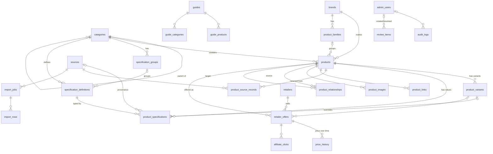

# Data model

PostgreSQL 16 with `pg_trgm` and `unaccent`. The schema lives in `src/db/schema/*.ts` (Drizzle,
`casing: snake_case`); every change goes through a migration in `src/db/migrations/`
(`0000`–`0002` and `0003`, `0005` are hand-written SQL: extensions, `sb_unaccent()`, triggers, the
indexability function and view). All primary keys are UUIDs; timestamps are `timestamptz`; most
tables have `created_at` / `updated_at` (maintained by the `sb_set_updated_at` trigger).

## Overview

## Catalogue

| Table                       | Purpose and key fields                                                                                                                                                                                                                                                                                                                                                                                                                                         | Constraints worth knowing                                                                                                                                                                    |
| --------------------------- | -------------------------------------------------------------------------------------------------------------------------------------------------------------------------------------------------------------------------------------------------------------------------------------------------------------------------------------------------------------------------------------------------------------------------------------------------------------- | -------------------------------------------------------------------------------------------------------------------------------------------------------------------------------------------- |
| `sources`                   | Provenance: name, `source_type` (manufacturer, licensed_provider, retailer, affiliate_network, manual_research, ai_extraction, community_submission), URL, licence type/notes, access method, `attribution_required`, **`usage_permitted`** (default false), `is_demo`                                                                                                                                                                                         | name unique (case-insensitive). Imports, source records and public images refuse sources with `usage_permitted = false`.                                                                     |
| `brands`                    | name, slug, description, official website, logo (storage key), country, `aliases[]`, `is_active`, `is_demo`                                                                                                                                                                                                                                                                                                                                                    | name unique ignoring case and accents; slug format check; trigram index on name.                                                                                                             |
| `categories`                | Tree via `parent_id`; slug, icon, sort order, SEO fields, `is_active`                                                                                                                                                                                                                                                                                                                                                                                          | Not its own parent; cycles prevented in the service (depth ≤ 8).                                                                                                                             |
| `product_families`          | Optional grouping of a brand's products (e.g. a series)                                                                                                                                                                                                                                                                                                                                                                                                        | (brand, slug) unique.                                                                                                                                                                        |
| `products`                  | Brand, category, family, name, slug, model name/number, MPN, `aliases[]`, descriptions, announced/release/discontinued dates, `product_status` (announced/active/discontinued/unknown), `publication_status` (draft/published/archived), `verification_status` (draft/needs_review/partially_verified/verified/rejected), `last_verified_at`, `is_featured`, `is_demo`, SEO fields, `search_vector` (FTS), `search_text` (brand + name, lowercased/unaccented) | Slug unique and never contains `-vs-` (reserved for comparisons); (brand, lower(model_number)) unique; GIN indexes for FTS and trigram search; B-tree on lower(model number) and lower(MPN). |
| `product_variants`          | Regional/configuration variants: name, `variant_code` (used in `?variant=`), MPN, `region_code` (NULL = global), colour, memory/storage configuration, label, GTIN, SKU, `is_default`, `is_active`                                                                                                                                                                                                                                                             | (product, code) unique; GTIN unique and 8/12/13/14 digits; exactly one default per product. Variants are never merged.                                                                       |
| `specification_groups`      | Display groups per category (key, name, order)                                                                                                                                                                                                                                                                                                                                                                                                                 | (category, key) unique.                                                                                                                                                                      |
| `specification_definitions` | Per category (inherited by subcategories): key, name, `data_type` (text, integer, decimal, boolean, date, enum, multi_select), `canonical_unit`, `validation_rules` (min/max/step/maxLength/options), filterable / comparable / required / public flags, `comparison_direction`                                                                                                                                                                                | (category, key) unique; units only on numbers; direction only on orderable types. Type and unit are frozen once values exist (service).                                                      |
| `product_specifications`    | One value per product (or variant override) and definition: exactly one of `value_text` / `value_numeric` / `value_boolean` / `value_date` / `value_json`, in the canonical unit; `source_id`, `origin` (manual/import/ai_extracted), `confidence`, `verification_status` (unverified/verified/rejected), `last_verified_at`                                                                                                                                   | Unique (product, variant, definition) with NULLs not distinct; "verified" requires `last_verified_at`; index (definition, value_numeric) for filters.                                        |
| `product_source_records`    | Which source said what about a product (optionally a variant): identifier and URL at the source, retrieval date, notes                                                                                                                                                                                                                                                                                                                                         | Unique (product, variant, source).                                                                                                                                                           |
| `product_links`             | Official/support/manual/driver/spec-sheet links, with source                                                                                                                                                                                                                                                                                                                                                                                                   | https only; shown publicly only when the source permits use.                                                                                                                                 |
| `product_images`            | Uploaded files only (`storage_key`, never a URL), alt text, type, source, licence, attribution, order, `is_primary`                                                                                                                                                                                                                                                                                                                                            | One primary per product; storage key can't be a URL.                                                                                                                                         |
| `product_relationships`     | successor / alternative / competitor / compatible_with / accessory_for / related, with confidence and source                                                                                                                                                                                                                                                                                                                                                   | Not self; unique per (source, target, type). For `successor` the source is the older product; "predecessor" is derived.                                                                      |

## Commerce

| Table              | Purpose and key fields                                                                                                                                                                                                                       | Constraints                                                                                                            |
| ------------------ | -------------------------------------------------------------------------------------------------------------------------------------------------------------------------------------------------------------------------------------------- | ---------------------------------------------------------------------------------------------------------------------- |
| `retailers`        | name, slug, https website, **`allowed_redirect_hosts[]`** (exact hosts `/go/` may redirect to), country, `supported_currencies[]`, affiliate network, `is_active`, `is_demo`                                                                 | Currencies are ISO codes; at least one.                                                                                |
| `retailer_offers`  | Product (+ optional variant) at a retailer in a market: product/affiliate URL (https), currency, price, original price, shipping (`numeric(14,4)`), availability, condition, source, `last_checked_at`, `expires_at`, `is_active`, `is_demo` | Natural key (retailer, product, variant, market, condition); prices > 0. Freshness rules live in `src/modules/offers`. |
| `price_history`    | Append-only price per offer at a time                                                                                                                                                                                                        | Written on creation and every price/currency change; never updated.                                                    |
| `affiliate_clicks` | Click on `/go/[offerId]`: time, market, referrer **host** only, bot flag                                                                                                                                                                     | No IP addresses, user agents or full URLs.                                                                             |

## Content

| Table                                          | Purpose                                                                                                                                         |
| ---------------------------------------------- | ----------------------------------------------------------------------------------------------------------------------------------------------- |
| `guides`, `guide_products`, `guide_categories` | Editorial guides (markdown rendered without raw HTML), linked to products and categories.                                                       |
| `featured_comparisons`                         | Curated 2–4 product comparisons for the homepage and brand pages.                                                                               |
| `slug_redirects`                               | Old → new slug per entity type (product, brand, category, guide); maintained without chains when slugs change; served as 301 by `src/proxy.ts`. |

## Operations

| Table          | Purpose and key fields                                                                                                                                                                                                                                                          |
| -------------- | ------------------------------------------------------------------------------------------------------------------------------------------------------------------------------------------------------------------------------------------------------------------------------- |
| `admin_users`  | email (lowercase, unique), name, argon2id `password_hash`, role (owner/editor), `is_active`, `last_login_at`.                                                                                                                                                                   |
| `audit_logs`   | Every admin change: actor, entity type/id, action, previous/new data (secrets redacted, password hashes never stored).                                                                                                                                                          |
| `import_jobs`  | CSV import: source, type (products/offers), file name, SHA-256 checksum, column mapping, status (uploaded/validated/committed/failed/cancelled), row counts, timing.                                                                                                            |
| `import_rows`  | Each staged row: raw cells, normalized data and notes, `row_hash`, action (create/update/skip/conflict/error), errors, matched product/variant.                                                                                                                                 |
| `review_items` | Verification queue: type (new_product, unverified_spec, conflicting_value, duplicate_candidate, variant_ambiguity, correction, suspicious_price), entity, payload, status (open/approved/rejected), creator, resolver, note. A check keeps status and `resolved_at` consistent. |
| `rate_limits`  | Fixed-window counters keyed by a hash (scope + address/email), pruned after a day.                                                                                                                                                                                              |

## Views and functions

- `sb_indexable_products(category_ids, brand_id, ids)` and the view `indexable_products`: the SQL
  form of the product indexability rule (`src/modules/seo/indexability.ts`), used by the sitemap
  and the category/brand/comparison checks. An integration test keeps both in step.
- `sb_unaccent(text)`: immutable wrapper around `unaccent` so it can be used in indexes.
- Triggers: `sb_set_updated_at` (all tables with `updated_at`), `sb_products_search_vector`
  (FTS document and `search_text`), `sb_brands_refresh_search` (brand renames refresh products).

## Demo data

Every seeded record has `is_demo = true` (brands, products, retailers, offers, sources, guides,
comparisons). Demo records are labelled in the UI, never indexed, excluded from the sitemap and
structured data, and the seed refuses to run in production unless `ALLOW_DEMO_SEED=true`.
